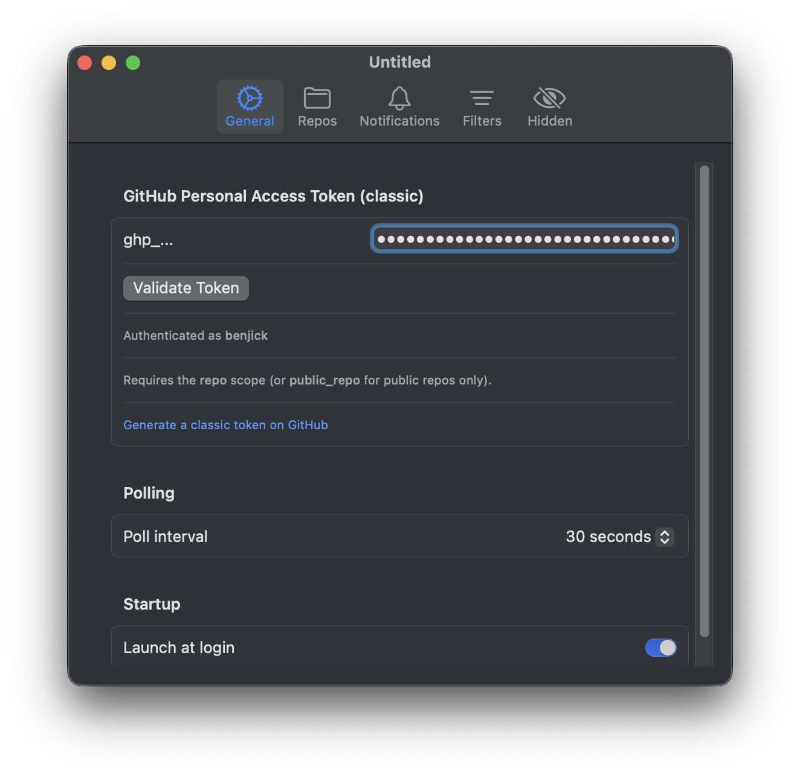
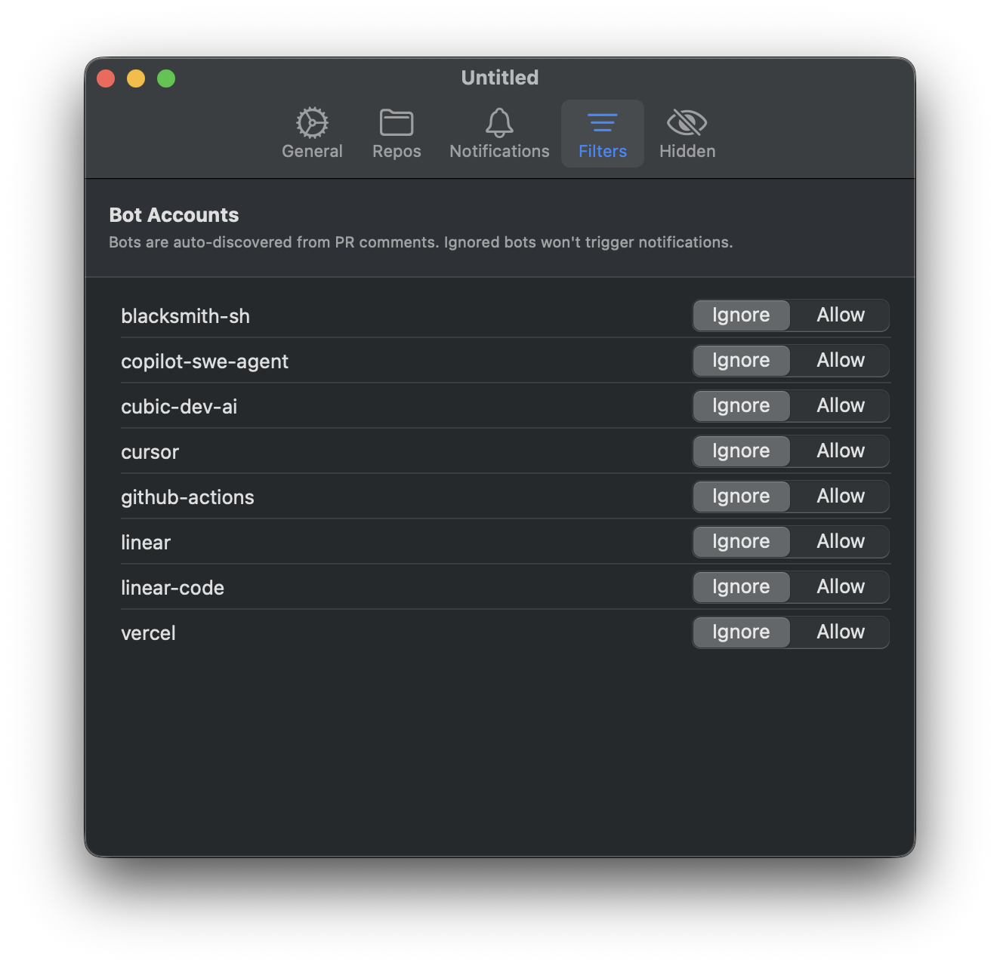

# PullRequests

A macOS menu bar app for keeping track of GitHub pull requests. It shows the
PRs that need your attention in a popover, with a badge count on the menu bar
icon, and sends native notifications for new comments, review changes,
finished CI runs and review requests.

<p>
  
  
  
</p>

## Install

```sh
brew install --cask benjick/tap/pullrequests
```

Update with `brew upgrade`.

Requires macOS 14 (Sonoma) or later on Apple Silicon.

The app is ad-hoc signed rather than notarised by Apple. The Homebrew cask
clears the quarantine flag on install so it opens normally. If you download
the zip from the releases page instead, macOS will refuse to open it until you
allow it in System Settings → Privacy & Security.

## Setup

1. Launch PullRequests. It lives in the menu bar; there's no Dock icon.
2. Open Settings from the gear icon in the popover.
3. **General:** paste a GitHub [personal access token (classic)](https://github.com/settings/tokens/new?scopes=repo&description=PullRequests)
   with the `repo` scope (or `public_repo` if you only watch public repos) and
   click **Validate Token**.
4. **Repos:** add the repositories to watch, as `owner/name`.

The token is stored in `~/.config/pullrequests/token`, readable only by your
user.

If your organisation uses SAML single sign-on, authorise the token for it on
GitHub (Settings → Developer settings → Tokens → Configure SSO), or the org's
repositories won't show up.

## Features

- One popover grouped into **Ready to Merge**, **Needs Your Review** and
  **Waiting for Review**, with CI and review status on each PR.
- Notifications for comments on your PRs, review status changes, CI
  completion and new review requests, each toggleable.
- Bot accounts are discovered from PR comments and can be ignored so they
  don't trigger notifications.
- Right-click a PR to open it, copy its URL, mute its notifications or hide it.
- Polls every 30 seconds by default, backing off automatically to stay within
  GitHub's API rate limits when you watch many repositories.

## Uninstall

```sh
brew uninstall --cask pullrequests          # remove the app
brew uninstall --cask --zap pullrequests    # also remove the token and settings
```

## Building from source

Requires Xcode or the Command Line Tools with Swift 5.9+.

```sh
git clone https://github.com/benjick/pullrequests.git && cd pullrequests
bash scripts/install.sh    # builds and copies PullRequests.app to /Applications
```

Local builds show version `dev` in Settings → General. Releases are built by
GitHub Actions when a `v*` tag is pushed and published to
[benjick/homebrew-tap](https://github.com/benjick/homebrew-tap).

## License

[MIT](LICENSE)
